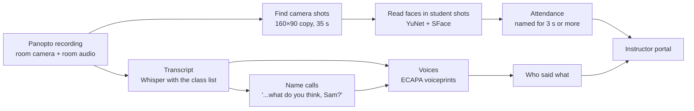
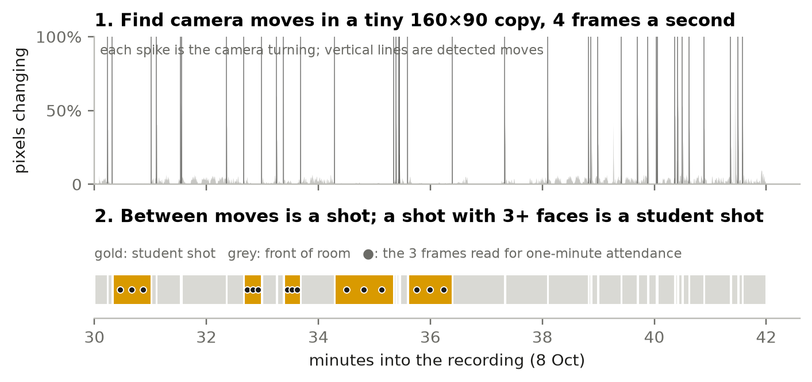
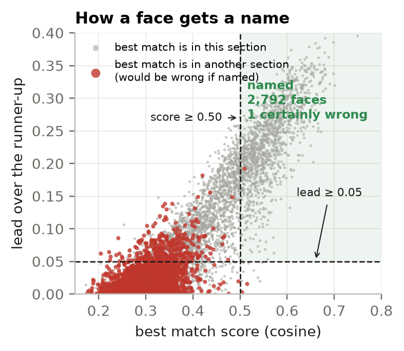
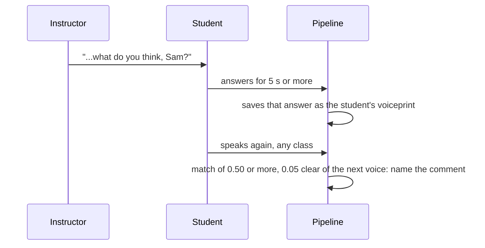
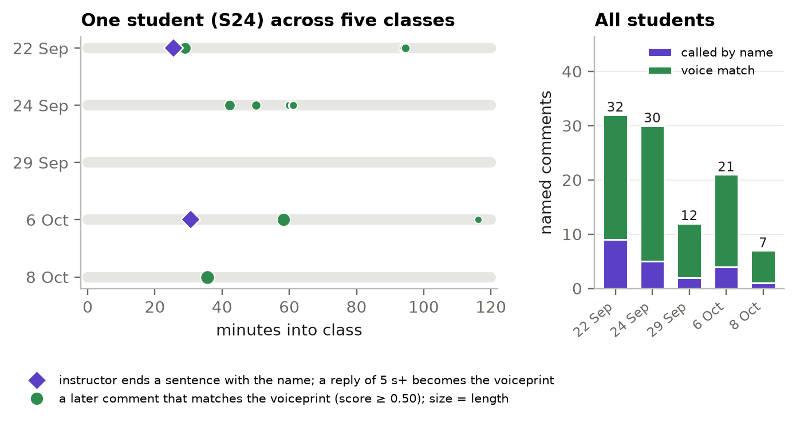
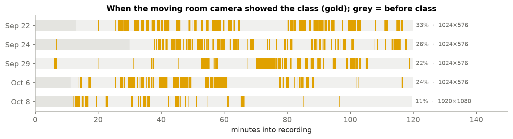
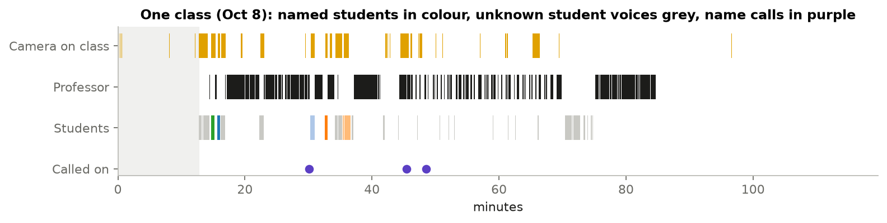

# Lecture capture as a classroom sensor

Can the lecture recordings a business school already makes take attendance and track class participation? This
repository has the code, the paper and de-identified results from a pilot on five two-hour classes of one section
(58 students) of a core MBA course at UC Berkeley Haas, recorded with Panopto in fall 2026.

- **Paper:** [`paper/main.pdf`](paper/main.pdf) (LaTeX source in [`paper/`](paper/))
- **Companion portal:** https://classroom-sensor.vercel.app: every class, timeline and student, with pseudonyms, blurred faces, no audio and
  no transcript text
- **Data:** [`data/results.json`](data/results.json) (aggregate and per-student results by anonymous id) and
  [`data/portal.json`](data/portal.json) (the portal's data)

Students consented to face recognition, voiceprints and recording, and the school approved the research use. Nothing
here identifies a student: names are replaced by anonymous ids (S01–S58) in the paper and by pseudonyms in the
portal, faces are blurred, and the recordings, face templates and voiceprints never left the pilot machine.

## Results in one minute

| Question | Answer |
|---|---|
| Can it name a face the camera shows? | Yes. 0 certain errors in 1,393 named faces at 1080p. |
| Can it take attendance? | It can say who was there, not who was absent: the camera showed students 11–33% of each class. 55 of 58 students were seen at least once across five classes. |
| How fast? | One-minute attendance reads three frames per camera shot and finds 86–88% of what a full scan finds. The full pipeline takes 10–12 minutes per class on one laptop. |
| Can it tell who spoke? | From voices, yes, once the instructor has called a student by name: 11 of 11 held-out comments within a class, 6 of 6 across classes. From video, no. |
| Can it judge contributions? | A rubric applied by Claude was consistent (124 of 128 scores identical across two runs) but has not been checked against an instructor. |

## How it works

Everything runs after class, from the recordings Panopto already makes.



**1. Find when the camera shows students.** The room camera turns toward whoever presses a desk microphone. A tiny,
fast copy of the video shows every turn as a spike; the stills between turns are shots, and a shot with three or more
faces is a student shot. One-minute attendance reads just three frames from each of those.



**2. Name a face only when the match is clear.** Each face is compared with seating-chart photos from all four
sections of the course. A name is given only when the best score is at least 0.50 and leads the runner-up by 0.05. A
match to a student from another section is certainly wrong, which is how errors are counted without hand labels.



**3. Learn voices from the instructor's name calls.** When the instructor ends a sentence with a student's name and a
student answers for five seconds or more, that answer becomes the student's voiceprint. Later comments, in any class,
are matched to it.





**4. What comes out.** Coverage limits attendance more than recognition does.





## Repository map

| Path | What |
|---|---|
| `classroom/` | The pipeline package: roster and consent, face and voice galleries, attendance, contributions, scoring, CLI |
| `analysis/` | The experiments in the paper: face indexing, presence, camera shots, voice bootstrapping, transcription speed, fast attendance, figures, the de-identified portal build |
| `portal-ui/` | The portal (React, shadcn/ui). `VITE_PUBLIC=1` builds the de-identified edition |
| `paper/` | The paper (LaTeX, compile with [Tectonic](https://tectonic-typesetting.github.io): `tectonic -X compile main.tex`) |
| `data/` | De-identified results and portal data |
| `tests/` | Pipeline tests (`pytest tests`) |

## Running it on your own recordings

```bash
python3 -m venv .venv && .venv/bin/pip install -r requirements.txt matplotlib scipy mlx-whisper
# per class: a folder with camera.mp4 (room camera) and audio.m4a (room audio), plus seating-chart photos
.venv/bin/python analysis/shots.py <class folder>
.venv/bin/python analysis/index_faces.py <class folder> <photos root> 1.0
.venv/bin/python analysis/transcribe_mlx.py <class folder> <section>
.venv/bin/python analysis/session_voice.py <class folder> words_mlx.json
```

The scripts expect the folder layout described in each file's docstring. Face templates and voiceprints are
biometric data: get consent, keep them on approved storage, and never commit them. Emotion or attention inference is
out of scope by design.

## Citation

Abhinav Gupta and Tess Rubin. *Lecture Capture as a Classroom Sensor: Automated Attendance and Participation from Existing
Recordings in an MBA Course.* Working paper, UC Berkeley, November 2026.
